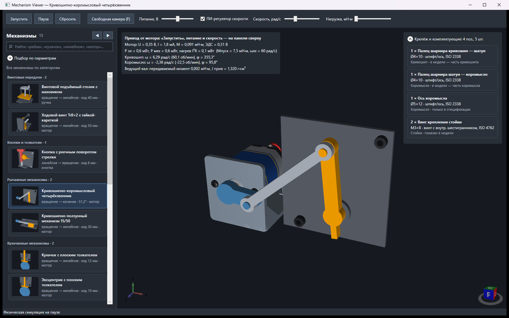
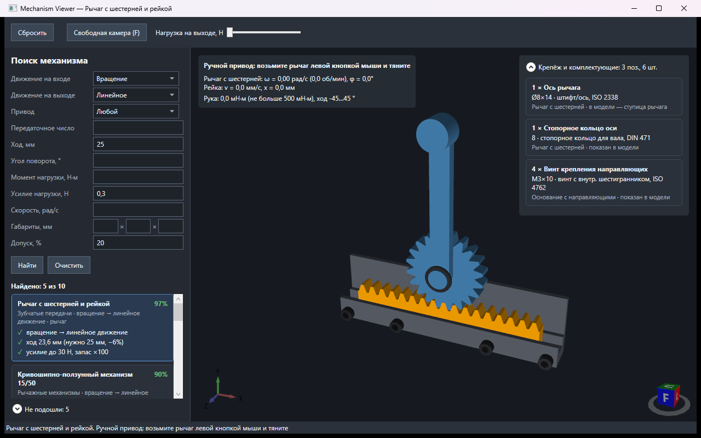
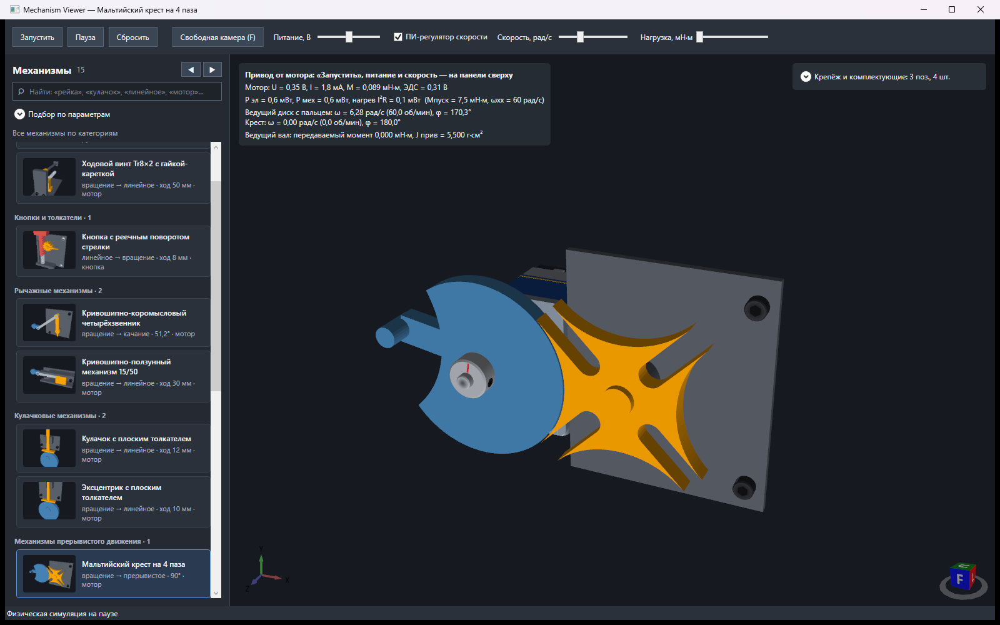
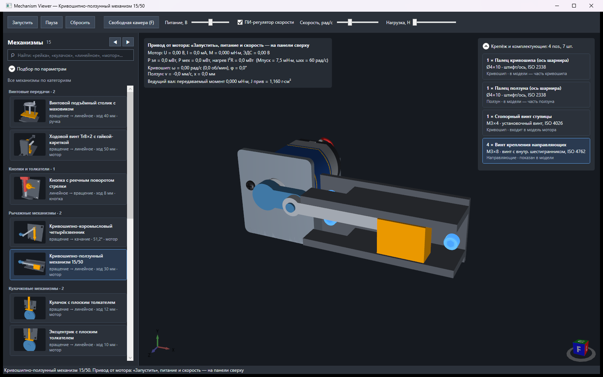
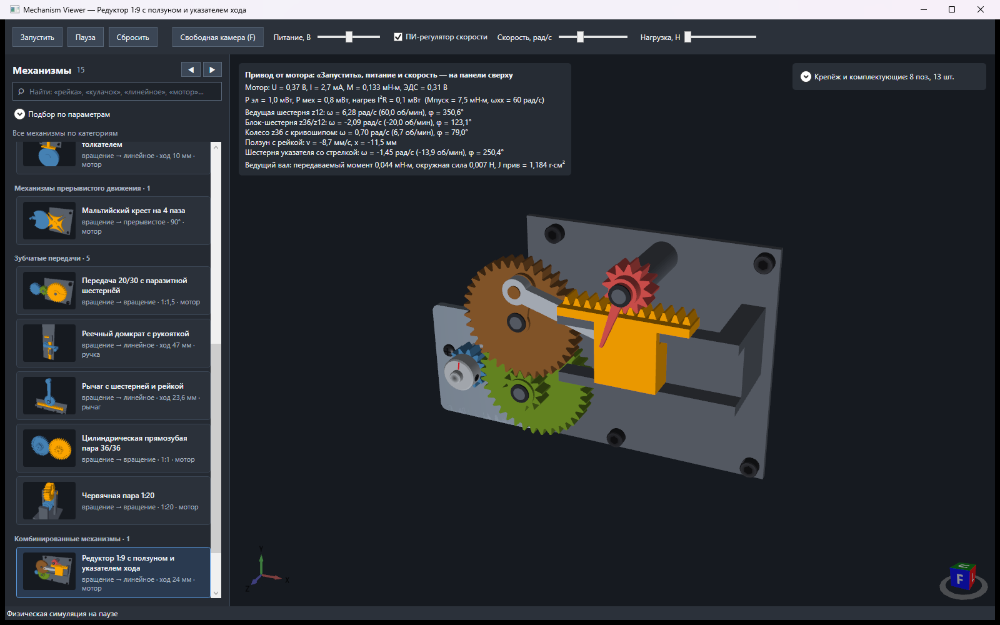

# MechanismViewer

WPF-приложение для подбора механизмов под техническое задание и их 3D-демонстрации с физикой. Механизмы описываются декларативно (`mechanism.json`), кинематика строится из типовых связей, динамика решается для одной обобщённой координаты с приведёнными параметрами.

**Стек:** C# (`LangVersion latest`, nullable) · .NET 10 (`net10.0-windows`) · WPF · [HelixToolkit.Wpf 3.1.2](https://github.com/helix-toolkit/helix-toolkit) · System.Text.Json · xUnit 2.9



## Содержание

- [Сборка и запуск](#сборка-и-запуск)
- [Архитектура](#архитектура)
- [Модель данных](#модель-данных)
- [Кинематика](#кинематика)
- [Динамика](#динамика)
- [Приводы и взаимодействие](#приводы-и-взаимодействие)
- [Подбор по параметрам](#подбор-по-параметрам)
- [Визуализация](#визуализация)
- [Валидация описаний](#валидация-описаний)
- [Тесты](#тесты)
- [Добавление механизма](#добавление-механизма)
- [Ограничения](#ограничения)

## Сборка и запуск

Нужны Windows и [.NET 10 SDK](https://dotnet.microsoft.com/download).

```powershell
git clone https://github.com/prop1l/MechanismViewer.git
cd MechanismViewer
dotnet run --project MechanismViewer
```

| Команда | Что делает |
|---|---|
| `dotnet build MechanismViewer.slnx` | Собрать приложение и тесты |
| `dotnet test MechanismViewer.Tests` | Запустить тесты |
| `dotnet test MechanismViewer.Tests --filter PartsDoNotPassThroughEachOther` | Только проверка пересечений деталей |

Каталог (`Catalog/**/*.json`, `Catalog/**/*.stl`) копируется в выходной каталог как `Content` и читается из `AppContext.BaseDirectory/Catalog` при запуске — пересобирать код ради нового механизма не нужно.

## Архитектура

```
mechanism.json ──► CatalogLoader ──► MechanismDefinition (record, immutable)
                    (JSON + валидация)        │
          ┌───────────────────────────────────┼──────────────────────────────┐
          ▼                                   ▼                              ▼
   MechanismSearch                     KinematicSolver                 MechanismScene
   фильтры + ранжирование       q → (q_i, k_i = dq_i/dq) по графу    ShapeBuilder / STL → MeshCache
                                        связей ICoupling              позы деталей, шатунов, крепежа
                                              │                              ▲
                                              ▼                              │
                                     MechanismSimulator ── q_i каждые 16 мс ─┘
                              J(q), b(q), c(q); мотор ПИ; рука; пружина;     (DispatcherTimer)
                                упоры; фиксированный шаг 1/480 с
                                              ▲
                                              │
                                  IDriver: MotorDriver / HandDragDriver / ButtonDriver
```

| Папка | Ключевые типы | Назначение |
|---|---|---|
| `Catalog/` | `CatalogLoader`, `MechanismDefinition`, `PartSpec`, `JointSpec`, `CouplingSpec`, `FastenerSpec` | Формат описания, загрузка и проверка; папки механизмов `<id>/mechanism.json` |
| `Kinematics/` | `ICoupling`, `LinearCoupling`, `KinematicSolver`, `Couplings/*` | Передаточные функции связей и обход графа механизма |
| `Physics/` | `MechanismSimulator`, `PhysicsBody`, `PhysicsMotor` | Интегрирование уравнений движения, модель двигателя постоянного тока |
| `Interaction/` | `IDriver`, `DriverFactory`, `HandDragDriver`, `ButtonDriver`, `MotorDriver` | Перевод действий мыши в воздействия на симулятор |
| `Search/` | `SearchQuery`, `MechanismSearch`, `SearchResultItem` | Подбор по параметрам, быстрый фильтр, карточки списка |
| `Visuals/` | `MechanismScene`, `ShapeBuilder`, `MeshKit`, `MeshCache`, `FastenerModel`, `MotorModel`, `ThumbnailRenderer`, `FreeFlyCamera` | Построение и размещение геометрии, подсветка, миниатюры, камера |
| `MainWindow.xaml(.cs)` | | UI, цикл отрисовки, привязка панели телеметрии |
| `MechanismViewer.Tests/` | | xUnit-тесты (см. [Тесты](#тесты)) |

Основные принципы:

- **Данные отделены от кода.** Механизм — это только JSON и (опционально) STL. Код знает 11 типов связей, 4 типа привода и ~10 примитивов геометрии; всё остальное — данные.
- **Одна степень свободы.** Состояние механизма — пара (q, ω) ведущей детали. Всё остальное выводится из неё кинематически.
- **Единицы.** В JSON — мм, градусы, Н, Н·м; внутри кинематики и физики — СИ (м, рад). Перевод — в `KinematicSolver` / `PhysicsBody` / `MechanismSimulator`.

## Модель данных

`MechanismDefinition` — неизменяемый `record`, десериализуемый `System.Text.Json` (регистронезависимые имена, комментарии и висячие запятые разрешены).

| Поле | Смысл |
|---|---|
| `id`, `name`, `category`, `description` | Идентификация и отображение |
| `motion { input, output }` | `rotation` · `linear` · `oscillation` · `intermittent` |
| `specs` | Паспорт для поиска: `ratio`, `strokeMm`, `angleDeg`, `maxTorqueNm`, `maxForceN`, `maxSpeedRadS` |
| `envelopeMm` | Габариты `[x, y, z]` |
| `driver` | `type` (`motor` · `lever` · `crank` · `button`), `part`, `range`, `handForce`, `spring`, `reverseAtLimits`, параметры посадки мотора |
| `output` | Выходная деталь (к ней приложена нагрузка); по умолчанию — последняя в порядке обхода |
| `parts[]` | Детали: геометрия (`shape` или `stl`), `joint`, масса/инерция, трение, `gear` |
| `couplings[]` | Кинематические связи между подвижными деталями |
| `fasteners[]` | Позиции спецификации, при наличии `positions` — с процедурной моделью |
| `designedContacts` | Пары деталей, пересекающихся по замыслу (для теста пересечений) |

Типы шарниров (`joint.type`):

| Тип | Координата | Поза в сцене |
|---|---|---|
| `revolute` | угол вокруг `axis` через `origin`, начальный — `phase`, ° | `R(axis, phase + q) · T(origin)` |
| `prismatic` | сдвиг вдоль `axis`, начальный — `phase`, мм | `T(axis·(phase + q)) · T(origin)` |
| `link` | нет (шатун/тяга/пружина) | строится между точкой `fromPoint` детали `from` и `toPoint` детали `to` |
| — (нет joint) | неподвижная | `T(origin)` |

С `joint.parent` поза детали умножается на позу несущей детали: деталь едет вместе с ней (ползун на каретке). Детали в сцене обновляются в порядке глубины цепочки `parent`, поэтому несущая всегда пересчитана раньше несомой.

## Кинематика

### Связь

```csharp
public interface ICoupling
{
    string From { get; }
    string To { get; }
    double Evaluate(double qFrom);   // q_to(q_from)
    double Derivative(double qFrom); // dq_to/dq_from
}
```

Координаты отсчитываются от начального положения (`phase`), в рад или м. Связи с постоянным отношением наследуют `LinearCoupling` (`q_to = k·q_from`).

### Решатель

`KinematicSolver` строит из `couplings` дерево обходом в ширину от ведущей детали и сохраняет плоский массив шагов `(coupling, fromIndex, toIndex)`. `Solve(q, Span<PartState>)` проходит его за O(n) без аллокаций:

```
q_0 = q,            k_0 = 1
q_j = f(q_i),       k_j = f'(q_i) · k_i        (цепное правило)
```

`k_i = dq_i/dq` — передаточная функция детали относительно ведущей; она же даёт скорости (`ω_i = k_i·ω`) и используется для приведения инерции и сил.

При построении проверяется: ведущая деталь подвижна; каждая подвижная деталь достижима от привода; ни одна деталь не получает движение по двум связям (замкнутые контуры запрещены); типы шарниров соответствуют связи.

### Типы связей

| Связь | Шарниры | Закон | Параметры |
|---|---|---|---|
| `gear` | rev → rev | θ₂ = −(z₁/z₂)·θ₁ | `ratio` или `gear.teeth` у обеих деталей |
| `belt` | rev → rev | θ₂ = (r₁/r₂)·θ₁, открытый ремень сохраняет направление | `ratio` |
| `rack` | rev ⇄ pri | x = r·θ (ведущей может быть любая сторона) | `radiusMm` (по умолчанию делительный радиус) |
| `screw` | rev → pri | x = p·θ/2π | `leadMm`, знак — направление |
| `crank-slider` | rev → pri | x(φ) = r·cos φ + √(L² − (r·sin φ − e)²) | `crankMm`, `rodMm`, `offsetMm` |
| `yoke` | rev → pri | x = r·cos(θ − γ), чистая гармоника | `crankMm`; эллипсограф — две такие связи |
| `four-bar` | rev → rev | φ = π + atan2(−A_y, d − A_x) − branch·acos((c² + e² − b²)/2ce) | `crankMm`, `couplerMm`, `rockerMm`, `branch` |
| `slotted-lever` | rev → rev | ψ = atan2(r·sin θ, d + r·cos θ), размах 2·asin(r/d) | `crankMm` |
| `cam` | rev → pri | кусочно: циклоида h(β/B − sin(2πβ/B)/2π) или гармоника h(1 − cos(πβ/B))/2 | `segments[]`: `angleDeg`, `riseMm`, `law` |
| `geneva` | rev → rev | палец в пазу: φ' = −atan2(r·sin θ', C − r·cos θ'), иначе выстой; r = C·sin(π/n) | `slots` |
| `wedge` | pri → pri | y = x·tg α | `angleDeg` |

Особенности:

- Длина стойки четырёхзвенника, межосевое мальтийского креста и кулисы берутся из `origin` деталей, а не из параметров связи.
- `four-bar` проверяет критерий Грасгофа и согласованность `phase` коромысла с собранной геометрией; при расхождении больше 0,5° загрузка падает с сообщением, какой `phase` нужен. То же для `slotted-lever`.
- `cam` требует замкнутого закона (Σ углов = 2π, Σ подъёмов = 0).
- Нелинейные связи дают `Derivative` аналитически или центральной разностью с шагом 1e-6 рад.

## Динамика

`MechanismSimulator` — система с одной степенью свободы. Параметры деталей приводятся к ведущей координате по принципу виртуальной работы:

```
J(q) = J_ротор + Σ J_i·k_i²
b(q) = b_ротор + Σ b_i·k_i²
c(q) = c_ротор + Σ c_i·|k_i| + |k_вых|·|нагрузка|
```

Уравнения (ток якоря + механика; без мотора Kt = 0):

```
L·di/dt = U − R·i − Ke·ω
J(q)·dω/dt = Kt·i − b(q)·ω − c(q)·sign(ω) − ½·J'(q)·ω² + F_внеш
F_внеш = f₀ − k·q − d·ω                       (пружина, постоянное усилие руки, «рука-пружина»)
```

Член ½·J'(q)·ω² учитывает переменную приведённую инерцию рычажных, кулачковых и мальтийских механизмов; J'(q) считается центральной разностью (шаг 1e-5). Для передач с постоянным отношением он равен нулю, и та же система вырождается в обычную зубчатую пару — отдельного кода под типы механизмов в физике нет.

**Интегрирование.** Фиксированный шаг `1/480 с` с аккумулятором времени (кадр не длиннее 0,1 с, чтобы после паузы не было «догоняния»). Схема полунеявная:

- ток, вязкое трение, жёсткость пружины и руки — неявный Эйлер; электрическое и механическое уравнения решаются совместно как линейная система 2×2 относительно (i₁, ω₁);
- сухое трение и ½·J'·ω² — явно;
- **залипание:** если |ω| < 1e-4 и движущая сила при заблокированном вале не превышает c(q), ω₁ = 0; сухое трение не может развернуть направление вращения за шаг.

**Упоры** (`driver.range`) — неупругий удар: координата обрезается, скорость в сторону упора обнуляется. С `reverseAtLimits` мотор на упоре меняет направление (ходовой винт).

**Телеметрия** на каждом шаге: напряжение, ток, момент на валу `DriveTorque` (с вычетом инерции и трения вала), окружная сила на делительной окружности ведущей шестерни, приведённая инерция, признак застопоривания (`IsStalled`: вал стоит при напряжении, равном напряжению питания).

### Мотор

`PhysicsMotor` — коллекторный двигатель постоянного тока типоразмера «380»: R = 20 Ом, L = 10 мГн, Kt = Ke = 0,05 Н·м/А, J_ротор = 1e-6 кг·м². Напряжение формирует ПИ-регулятор скорости (Kp = 0,2 В·с/рад, Ki = 2 В/рад) с ограничением выхода напряжением питания и anti-windup: интегратор не растёт за точку насыщения, поэтому при упоре выход ровно ±U_пит и после снятия нагрузки нет перерегулирования. Регулятор можно отключить — тогда на якорь подаётся всё напряжение.

### Детали

`PhysicsBody.FromPart`: для `prismatic` нужна `massKg`, для `revolute` — `inertiaKgM2` или `gear` (тогда J = m·r²/2 сплошного диска радиуса впадин при плотности `densityKgM3`). Трение по умолчанию: 2e-6 Н·м·с/рад и 2e-5 Н·м для вращения, 0,05 Н·с/м и 0,02 Н для сдвига.

## Приводы и взаимодействие

`DriverFactory` выбирает реализацию `IDriver` по `driver.type`. Окно передаёт драйверу луч под курсором (`Ray3D`), драйвер превращает его в воздействие на симулятор.

| Привод | Реализация | Модель |
|---|---|---|
| `motor` | `MotorDriver` | Симуляция идёт по кнопке «Запустить», мотор управляется слайдерами (питание, скорость, нагрузка) |
| `lever`, `crank` | `HandDragDriver` | Курсор проецируется на плоскость вращения (или на ось сдвига); угол накапливается, поэтому ручку можно крутить на много оборотов. Положение становится `HandTarget` |
| `button` | `ButtonDriver` | Пока зажата ЛКМ — постоянное усилие `handForce`, после отпускания возвращает пружина |

**Рука** моделируется как пружина с критическим демпфированием к `HandTarget`: жёсткость `k = max(J·ω₀², F_max/δ)` при ω₀ = 2π·8 Гц и δ = 0,5° / 0,2 мм, демпфер `2√(kJ)`. Если требуемое усилие превышает `handForce`, шаг пересчитывается с предельным усилием — рука «не дотягивает», а не продавливает нагрузку. Это исключает перерегулирование при быстрых движениях мыши и даёт физически честный недоход при перегрузке.

## Подбор по параметрам

`MechanismSearch.Run(catalog, query)` работает в два этапа.

**1. Жёсткие фильтры** (с текстом причины отказа): вид движения на входе и выходе, тип привода (`manual` = `lever` | `crank`), допустимый момент/усилие на выходе, допустимая скорость, габариты. Габариты сравниваются после сортировки размеров, то есть с учётом поворота на 90° вокруг любой оси.

**2. Ранжирование:** оценка = 100 − Σ штрафов, с пояснением к каждому слагаемому.

| Критерий | Штраф |
|---|---|
| Кинематика (передаточное число, ход, угол) | Отклонение в логарифмах `|ln(факт/нужно)|`, чтобы ×2 и ×0,5 весили одинаково. В допуске — до 10, за допуском — ещё до 40 (полностью при отклонении в 2 раза сверх допуска). Нет в паспорте — 20 |
| Нагрузка | Запас < 1,25 — 10; нет данных или нагрузка другого типа — 15 |
| Скорость | Нет данных — 5 |
| Габариты | До 5 пропорционально заполнению объёма (при равной кинематике выше компактный); нет данных — 5 |

**Быстрый фильтр** над списком — независимый от подбора: все слова запроса должны найтись в названии, категории или описании; сравнение по основе слова, поэтому «рейка» находит «рейкой».

## Визуализация

**Цикл отрисовки.** `DispatcherTimer` с интервалом 16 мс: `simulator.Step(Δt)` → `scene.Update(id => body.Coordinate)` → обновление панели телеметрии. Физика при этом идёт своим фиксированным шагом, независимо от частоты кадров.

**`MechanismScene`** строит `ModelVisual3D` на каждую деталь и на каждый `Update` выставляет `MatrixTransform3D`. Шатун (`link`) ставится по двум мировым точкам: ось X — от начала к концу, ось Z — нормаль из `joint.axis`, ортогонализованная к X; у пружин (`stretchLengthMm`) длина масштабируется, сечение — нет. Крепёж задан в системе своей детали и получает её позу.

**Подсветка** без пересоздания материалов: у каждой детали `MaterialGroup` с собственным `EmissiveMaterial`, подсветка меняет только его цвет. Поэтому сетки можно делить между деталями, а материалы — нет.

**`ShapeBuilder`** строит сетку детали из примитивов `shape` (мм, система детали). Каждое тело замкнуто, с внешними нормалями; пересекающиеся тела не сливаются (CSG не нужен для показа). Особые примитивы:

- `gear` — трапециевидный зуб с углом профиля 20° и боковым зазором 0,12·m на сторону (прямые боковины вместо эвольвенты);
- `cam` — контур как огибающая положений тарелки плоского толкателя: `H(ψ)·n(ψ) + H'(ψ)·t(ψ)`, `H = r_b + s(θ)`, закон берётся из связи `cam` этой детали;
- `genevaStar` / `genevaDisk` — пазы и запирающая дуга по тем же C, n, что и связь;
- `belt` — дуги охвата π ± 2β и ветви по внешним касательным, sin β = (r₁ − r₂)/D;
- `thread` — правая резьба; `shapeAxis: "x" | "y"` переориентирует всю форму.

Многоугольники триангулируются «отрезанием ушей».

**`MeshCache`.** Ключ — SHA-256 от содержимого STL или канонического описания `shape`, а не от пути. Сетка строится один раз, замораживается (`Freeze`: доступна из любого потока, без уведомлений об изменениях) и делится между всеми одинаковыми деталями — двумя шестернями пары, одинаковыми кривошипами разных механизмов, при повторном открытии. Ссылки слабые (`WeakReference`): сетки закрытого механизма собирает GC. Доступ потокобезопасен; при гонке побеждает первая построенная копия.

**`ThumbnailRenderer`** рисует миниатюры вне экрана в 2× разрешении (`RenderTargetBitmap`), камера охватывает описанную сферу сцены. Миниатюры рендерятся по одной с приоритетом `ApplicationIdle` — окно открывается сразу, картинки появляются следом; благодаря `MeshCache` открытие механизма после миниатюры почти не стоит парсинга.

**`FastenerModel`** — процедурный крепёж по номинальным d и L: ISO 4762 (винт с внутренним шестигранником), ISO 7049 (саморез), ISO 4026 (установочный винт), ISO 2338 (штифт), DIN 471 (стопорное кольцо). **`MotorModel`** — процедурная модель мотора «380» с кронштейном и энкодером; ротор вращается вместе с ведущим валом. Обе модели строятся через `MeshKit` (тела вращения по профилю, лофт, призмы, трубки) с корректными нормалями: дублированная вершина профиля даёт острое ребро.

**`FreeFlyCamera`** — свободная камера поверх `HelixViewport3D` с плавным разгоном (сглаживание 12 1/с); на время полёта стандартные орбитальные жесты Helix отключаются.

## Валидация описаний

Ошибка в `mechanism.json` выдаётся при загрузке с путём к файлу и понятным сообщением, а не падением в рантайме.

| Этап | Проверки |
|---|---|
| `CatalogLoader` | Уникальность id деталей; ровно одно из `stl` / `shape`; один примитив на элемент `shape`; `shapeAxis` ∈ {x, y, z}; размерность векторов; ссылки связей, шатунов, привода, выхода и крепежа на существующие детали; шатун соединяет только детали с шарнирами; цепочка `parent` без циклов и без шатунов; детали `four-bar` / `geneva` / `slotted-lever` / `cam` стоят на стойке |
| `KinematicSolver` | Подвижность ведущей детали; связность графа; отсутствие замкнутых контуров; соответствие типов шарниров связи; наличие обязательных параметров; согласованность `phase` у `four-bar` и `slotted-lever` |
| `PhysicsBody` | Наличие массы или инерции у каждой подвижной детали |

## Тесты

`dotnet test MechanismViewer.Tests`. Тесты, создающие WPF-объекты, выполняются в STA-потоке.

| Файл | Что проверяется |
|---|---|
| `CouplingTests` | Законы `gear`, `rack`, `screw`, `crank-slider`: ход в мёртвых точках, учёт фазы, отказ при L < r |
| `KinematicSolverTests` | Цепное правило по цепочке, отказ при несвязной детали, замкнутом контуре, неверных шарнирах |
| `SimulatorTests` | Каждый механизм каталога собирается и движется; ползун не выходит за ход, приведённая инерция меняется с углом |
| `ManualDriveTests` | Рычаг следует за рукой без перерегулирования, останавливается на упоре, рука не продавливает нагрузку сверх предела; кнопка и возвратная пружина |
| `NewMechanismTests` | Каждый тип связи на реальных механизмах каталога: Грасгоф и угол качания, контакт кулачка с толкателем на всех углах, непрерывность и выстой мальтийского креста, реверс винта, червячная пара, быстрый возврат кулисы, клин, ремень, клиновой захват (симметрия губок, пальцы в пазах клина, пружина), перекладчик (передача ×4, ролик на балке, губки на кубике, ролики на контурах кулачков), циклы `parent` |
| `SearchTests` | Фильтры и ранжирование на тестовом и полном каталоге, допуск, запас по нагрузке, габариты с поворотом, быстрый фильтр |
| `SceneTests` | `MeshCache`: общие сетки для одинаковых STL и форм, повторное открытие без парсинга, конкурентное построение, раздельная подсветка; миниатюры |
| `FastenerTests` | Количество по позициям, крепёж движется с деталью, подсветка, геометрия процедурных моделей |
| `CollisionTests` | См. ниже |

Два теста параметризованы по всему каталогу и автоматически подхватывают новые механизмы:

- **`EveryCatalogEntry_BuildsAndRuns`** — механизм загружается, строится сцена, симуляция движется.
- **`PartsDoNotPassThroughEachOther`** — механизм проводится по всему ходу (120 положений), для каждой пары тел (детали, крепёж, статор и ротор мотора) считается объём взаимного проникновения. Каждое тело вокселизуется в своей системе координат (ячейка 0,25 мм, «внутри» — по числу пересечений вдоль Z). Для отсечения пар используется грубая карта 2 мм, консервативная по построению: «нет рядом» гарантирует отсутствие тела в ячейке. Пересечения меньше 1 мм³ считаются погрешностью сетки. Для пар из `designedContacts` допускается постоянное пересечение (ось в ступице, винт в гайке), но не меняющееся по ходу.

## Добавление механизма

1. Создать папку `MechanismViewer/Catalog/<id>/`.
2. Описать геометрию каждой детали в её собственной системе координат: ось шарнира — через начало координат, единицы — мм. Шатун строится от первой шарнирной точки вдоль +X. Простые детали — примитивами `shape`, CAD-модели — файлом `stl` рядом с `mechanism.json`.
3. Описать механизм:

```jsonc
{
  "id": "crank-slider-15-50",
  "name": "Кривошипно-ползунный механизм 15/50",
  "category": "Рычажные механизмы",
  "motion": { "input": "rotation", "output": "linear" },
  "specs": { "strokeMm": 30, "maxForceN": 0.4, "maxSpeedRadS": 20 },
  "envelopeMm": [105, 50, 60],
  "driver": { "type": "motor", "part": "crank", "motorGapMm": 6.0 },
  "output": "slider",
  "parts": [
    { "id": "crank", "color": "#4682B4",
      "shape": [
        { "cylinder": { "r": 6, "z": [0, 5] } },                                 // ступица
        { "box": [0, -4, 0, 15, 4, 5] },                                         // плечо
        { "cylinder": { "at": [15, 0], "r": 2, "z": [5, 10], "segments": 24 } }  // палец
      ],
      "joint": { "type": "revolute", "origin": [0, 0, 0], "axis": [0, 0, 1], "phase": 0 },
      "inertiaKgM2": 1.6e-7 },
    { "id": "slider", "color": "#FFA500", "shape": [ { "box": [-9, -7, 10, 9, 7, 18] } ],
      "joint": { "type": "prismatic", "origin": [65, 0, 0], "axis": [1, 0, 0] },
      "massKg": 0.0031 },
    { "id": "rod", "shape": [ { "box": [0, -2.5, 5.5, 50, 2.5, 9] } ],
      "joint": { "type": "link", "axis": [0, 0, 1],
                 "link": { "from": "crank", "fromPoint": [15, 0, 0], "to": "slider", "toPoint": [0, 0, 0] } } },
    { "id": "guide", "stl": "Guide.stl" }                                        // без joint — стойка
  ],
  "couplings": [
    { "type": "crank-slider", "from": "crank", "to": "slider", "crankMm": 15, "rodMm": 50 }
  ],
  "fasteners": [
    { "kind": "Винт крепления направляющих", "size": "M3×8", "type": "socket-screw",
      "diameterMm": 3, "lengthMm": 8, "positions": [[30, 4.5, 2], [80, 4.5, 2]],
      "axis": [0, 0, -1], "attachedTo": "guide" }
  ]
}
```

4. Запустить `dotnet test MechanismViewer.Tests`. Если детали входят друг в друга по замыслу (отверстия в моделях не вырезаны), перечислить пары в `designedContacts`, например `[["gear", "frame"]]`.

### Примитивы `shape`

| Примитив | Что строит |
|---|---|
| `box: [x0, y0, z0, x1, y1, z1]` | Параллелепипед |
| `cylinder: { at, r, z: [от, до], segments }` | Цилиндр с осью Z |
| `polygon: { points: [[x, y], …], z }` | Простой многоугольник, выдавленный по Z |
| `gear: { at, module, teeth, phaseDeg, z }` | Прямозубое колесо, первый зуб на `phaseDeg` |
| `rack: { origin, direction, module, teeth: [k₀, k₁], z }` | Зубья рейки, зуб k — на k·π·m |
| `thread: { r: [впадина, вершина], pitch, z, width: [у впадины, у вершины] }` | Правая резьба вокруг Z |
| `ringX: { x: [от, до], r: [внутр., наружн.] }` | Кольцо вокруг оси X (виток пружины) |
| `cam: { z, follower, rollerRadius }` | Контур кулачка по закону связи `cam` этой детали: под плоский толкатель или, с `rollerRadius`, под ролик (начало координат толкателя — центр ролика). `follower` выбирает связь, если на валу несколько кулачков |
| `genevaStar` / `genevaDisk: { slots, centerDistance, slotWidth, pinRadius, z }` | Мальтийский крест / запирающий диск |
| `belt: { pulleys: [[x, y, r], [x, y, r]], thickness, z }` | Плоский ремень по внешним касательным |

### Параметры привода

| Поле | Привод | Смысл |
|---|---|---|
| `range: [min, max]` | все | Упоры, ° или мм от начального положения |
| `handForce` | ручные | Предельное усилие руки, Н·м или Н (по умолчанию 0,5 Н·м / 10 Н) |
| `spring: { stiffness, preload }` | ручные | Возвратная пружина |
| `reverseAtLimits` | `motor` | Реверс на упорах |
| `motorGapMm`, `hubSeatMm`, `shaftEndMm` | `motor` | Посадка модели мотора на ведущую деталь |

## Каталог

58 механизмов в 11 категориях: зубчатые передачи (21), рычажные (13), кулачковые (7), винтовые (5), прерывистого движения (4), захваты и манипуляторы (3), ременные, зажимы, клиновые, кнопки, комбинированные (по 1). Зубчатая пара использует CAD-детали (STL), остальные — заготовки из примитивов `shape`.

<details>
<summary>Скриншоты</summary>

**Подбор:** запрос «вращение → линейное, ход 25 мм, усилие 0,3 Н» — 26 механизмов из 50 подходят, 24 отсеяны с причинами.



**Мальтийский крест под мотором** в фазе выстоя, справа — телеметрия мотора.



**Спецификация:** выбранная позиция подсвечивает все четыре винта.



**Каталог с миниатюрами.**



</details>

### Управление

| Действие | Как |
|---|---|
| Выбрать механизм | Клик по карточке, ↑/↓; соседний — ◀ ▶ или Ctrl+←/→ |
| Быстрый фильтр | Ввод над списком; Enter — открыть первый, ↓ — к списку, Esc — очистить |
| Мотор | «Запустить» / «Пауза», слайдеры питания, скорости, нагрузки |
| Рычаг, ручка, кнопка | ЛКМ на подсвеченной детали |
| Камера | ПКМ — вращение (Helix); `F` — свободная камера: ПКМ обзор, `WASD`, `E`/`Q`, Shift/Ctrl — скорость, `Esc` — выход |
| Крепёж | Клик по строке спецификации подсвечивает элемент |

## Ограничения

- **Только одна степень свободы, только дерево связей.** Замкнутые контуры и дифференциалы не поддерживаются: каждая деталь получает движение по одной связи.
- Масса детали на подвижной несущей (`parent`) учитывается только в её собственном движении; несомую массу нужно добавлять к несущей вручную. Масса шатунов и пружин не учитывается.
- КПД винтовых и червячных передач не моделируется, только трение. Ремень без проскальзывания и показан неподвижным.
- Оси мотора, четырёхзвенника, качающейся кулисы и мальтийского креста — только вдоль Z (геометрия связей считается в плоскости XY).
- Зубья — трапеция вместо эвольвенты; зацепление червяка с колесом приближённое; тела `shape` не объединяются (нет CSG), отверстия не вырезаются.
